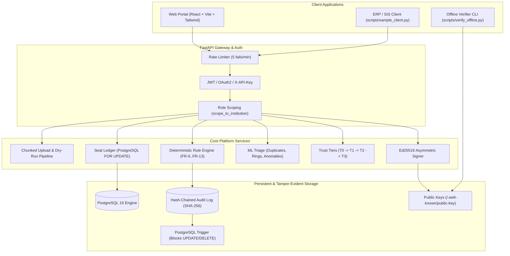

# APAAR Ledger — Provable Student Enrolment Platform

SIH 2026, Problem Statement SIH26263 (AICTE, Regulation Bureau). Team Spitzen Squad (P121).

> **We do not just collect student data; we make every enrolment number provable, bucket by bucket and student by student, without exposing anyone's data.**

The authoritative build specification is [`docs/APAAR_Ledger_Build_Spec.md`](docs/APAAR_Ledger_Build_Spec.md).
Design decisions are logged in [`docs/decisions.md`](docs/decisions.md).
OWASP ASVS security audit checklist is in [`docs/security.md`](docs/security.md).
System evaluation benchmarks are in [`docs/evaluation.md`](docs/evaluation.md).

---

## Status

| Phase | Scope | State |
| :--- | :--- | :--- |
| **Phase 1** | Foundation: Compose, PostgreSQL 16, FastAPI, JWT auth + RBAC, Alembic migrations, idempotent seed, login UI + role shells | **Done** (63 tests) |
| **Phase 2** | Data model (all spec 7.1 tables), synthetic national generator (40 insts / 20k students), MOCK APAAR registry, Devanagari normaliser, Fernet field encryption | **Done** (132 tests) |
| **Phase 3** | Rule engine (FR-6 to FR-13, timelines, transfer-awareness), atomic flag-mode Seat Ledger with row-level locks, rules-as-data admin, Student Record Form UI | **Done** (246 tests) |
| **Phase 4** | Chunked CSV upload, dry-run with suggested fixes & projected bucket impact, maker-checker dual control, T0-T2 trust tiers, hash-chained audit log | **Done** (269 tests) |
| **Phase 5** | ML triage engine: LightGBM calibrated duplicate matcher, Isolation Forest anomaly detector with Z-scores, Louvain contact ring detector, Review Queue UI | **Done** (286 tests) |
| **Phase 6** | AICTE National Apex Dashboard with SSE live updates, Headcount Coverage Meter, Data Health Score, Risk Ranking, 7 statutory CSV/JSON reports | **Done** (300 tests) |
| **Phase 7** | Student confirmation T3 elevation, enrolment dispute, selective disclosure consent, Ed25519 credential signing, offline QR verifier, public verification portal | **Done** (315 tests) |
| **Phase 8** | Demo mode: 6 fraud-injection scenarios, 50-thread concurrency race runner, audit log tamper simulator, live evaluation runner across all 7 criteria | **Done** (328 tests) |
| **Phase 9** | Hardening: login rate limiting (token bucket), per-institution ERP API keys (FR-39), security checklist, performance benchmark script, traceability table | **Done** (340+ tests) |

---

## Architecture Overview



---

## Quick Start

### Docker Compose
```bash
docker compose up --build        # or: make up
```

| Service | URL | Notes |
| :--- | :--- | :--- |
| **Web UI** | http://localhost:5173 | React single-page app |
| **API Docs (Swagger)** | http://localhost:8000/docs | Interactive OpenAPI documentation |
| **Health Check** | http://localhost:8000/health | Liveness & DB connectivity |
| **Public Key Endpoint** | http://localhost:8000/.well-known/public-key | Ed25519 active verification keys |
| **PostgreSQL** | localhost:5432 (`apaar` / `apaar`) | Relational database with pg_trgm |

### Demo Accounts
All demo accounts use the standard password: **`Demo@2026`** (env `DEMO_PASSWORD`).

| Role | Email | Scope / Landing Page | Key Capabilities |
| :--- | :--- | :--- | :--- |
| `AICTE_ADMIN` | `admin@aicte.demo` | `/aicte/dashboard` | National KPIs, review queue decisions, quota rules editor, demo mode, evaluation runner |
| `AICTE_REVIEWER` | `reviewer@aicte.demo` | `/aicte/review` | Case inspection, ML feature attributions, evidence diffs, case decisions |
| `INST_MAKER` | `maker@inst1.demo` | `/institution/dashboard` | Single record entry, CSV upload wizard, dry-run fix inspections, ERP API keys |
| `INST_CHECKER` | `checker@inst1.demo` | `/institution/approvals` | Batch approval/rejection (maker != checker enforced) |
| `VERIFIER` | `verifier@employer.demo` | `/verifier/portal` | Verification requests, credential scanning, offline QR validation |
| `STUDENT` | `student@student.demo` | `/student/portal` | Enrolment confirmation (T3 elevation), dispute ("Not me"), selective disclosure consent |

---

## Frozen PPT Claims Traceability Table

Every claim promised in the SIH presentation contract (P1 to P24) is implemented in code and tested:

| # | PPT Claim | Requirement | Code Implementation | Verification Test File |
| :--- | :--- | :--- | :--- | :--- |
| **P1** | Registrar approves before records reach AICTE; maker cannot approve own batch | FR-1, FR-17 | [`app/services/uploads.py`](file:///home/kishorveeraragavan/Documents/APAAR_ID_Validation/backend/app/services/uploads.py), [`app/api/uploads.py`](file:///home/kishorveeraragavan/Documents/APAAR_ID_Validation/backend/app/api/uploads.py) | `test_uploads.py` |
| **P2** | Real-time monitoring & validation via live SSE event stream | FR-22 | [`app/api/dashboards.py`](file:///home/kishorveeraragavan/Documents/APAAR_ID_Validation/backend/app/api/dashboards.py), [`app/core/events.py`](file:///home/kishorveeraragavan/Documents/APAAR_ID_Validation/backend/app/core/events.py) | `test_phase6_dashboards_reports.py` |
| **P3** | Hybrid engine: rules decide, ML ranks and suggests, humans confirm | FR-14, NFR-8 | [`app/services/rule_engine.py`](file:///home/kishorveeraragavan/Documents/APAAR_ID_Validation/backend/app/services/rule_engine.py), [`app/services/triage.py`](file:///home/kishorveeraragavan/Documents/APAAR_ID_Validation/backend/app/services/triage.py) | `test_phase5_ml_triage.py` |
| **P4** | Seat Ledger: per-bucket intake tracking (supernumerary, lateral), flagged at upload | FR-10, FR-11 | [`app/services/seat_ledger.py`](file:///home/kishorveeraragavan/Documents/APAAR_ID_Validation/backend/app/services/seat_ledger.py), [`app/services/quota.py`](file:///home/kishorveeraragavan/Documents/APAAR_ID_Validation/backend/app/services/quota.py) | `test_seat_ledger.py` |
| **P5** | Student-confirmed enrolment with progressive trust tiers T0 to T3 | FR-18 to FR-20 | [`app/services/trust.py`](file:///home/kishorveeraragavan/Documents/APAAR_ID_Validation/backend/app/services/trust.py), [`app/api/confirmations.py`](file:///home/kishorveeraragavan/Documents/APAAR_ID_Validation/backend/app/api/confirmations.py) | `test_phase7_verification.py` |
| **P6** | ML duplicate matcher with confidence zones; transfer-aware interval checks | FR-14, ML-1 | [`app/ml/dedupe.py`](file:///home/kishorveeraragavan/Documents/APAAR_ID_Validation/backend/app/ml/dedupe.py), [`app/services/rule_engine.py`](file:///home/kishorveeraragavan/Documents/APAAR_ID_Validation/backend/app/services/rule_engine.py) | `test_phase5_ml_triage.py` |
| **P7** | Impossible-timeline detection (overlapping degrees, short diploma, lateral entry) | FR-13, 9.5 | [`app/services/rule_engine.py`](file:///home/kishorveeraragavan/Documents/APAAR_ID_Validation/backend/app/services/rule_engine.py) | `test_phase3_rules.py` |
| **P8** | Privacy-preserving hashed duplicate check & zero-knowledge institution isolation | FR-37 | [`app/services/privacy_tokens.py`](file:///home/kishorveeraragavan/Documents/APAAR_ID_Validation/backend/app/services/privacy_tokens.py), [`app/core/crypto.py`](file:///home/kishorveeraragavan/Documents/APAAR_ID_Validation/backend/app/core/crypto.py) | `test_phase2_synth.py` |
| **P9** | Offline-verifiable signed QR credentials and student verifier access log | FR-30 to FR-33 | [`app/services/signing.py`](file:///home/kishorveeraragavan/Documents/APAAR_ID_Validation/backend/app/services/signing.py), [`app/api/verification.py`](file:///home/kishorveeraragavan/Documents/APAAR_ID_Validation/backend/app/api/verification.py) | `test_phase7_verification.py` |
| **P10** | Consent-based verification: only student-approved fields disclosed | FR-28 to FR-31 | [`app/api/verification.py`](file:///home/kishorveeraragavan/Documents/APAAR_ID_Validation/backend/app/api/verification.py) | `test_phase7_verification.py` |
| **P11** | Degree certificate print view: APAAR ID + student ID + signed offline QR code | FR-34 | [`app/api/verification.py`](file:///home/kishorveeraragavan/Documents/APAAR_ID_Validation/backend/app/api/verification.py), `CertificateView.tsx` | `test_phase7_verification.py` |
| **P12** | Statutory CSV and JSON reports for accreditation, monitoring, and policy | FR-24 | [`app/api/reports.py`](file:///home/kishorveeraragavan/Documents/APAAR_ID_Validation/backend/app/api/reports.py) | `test_phase6_dashboards_reports.py` |
| **P13** | Dry-run upload validation with suggested fixes and projected seat impact | FR-3 | [`app/services/uploads.py`](file:///home/kishorveeraragavan/Documents/APAAR_ID_Validation/backend/app/services/uploads.py), `UploadWizardPage.tsx` | `test_uploads.py` |
| **P14** | Headcount Coverage Meter: declared intake vs uploaded student records | FR-21 | [`app/api/dashboards.py`](file:///home/kishorveeraragavan/Documents/APAAR_ID_Validation/backend/app/api/dashboards.py) | `test_phase6_dashboards_reports.py` |
| **P15** | Phonetic candidate blocking + Platt-calibrated LightGBM classifier | ML-1 | [`app/ml/dedupe.py`](file:///home/kishorveeraragavan/Documents/APAAR_ID_Validation/backend/app/ml/dedupe.py), [`app/ml/train.py`](file:///home/kishorveeraragavan/Documents/APAAR_ID_Validation/backend/app/ml/train.py) | `test_phase5_ml_triage.py` |
| **P16** | Isolation Forest on 9 peer-normalised metrics with Z-score feature attributions | ML-2 | [`app/ml/anomaly.py`](file:///home/kishorveeraragavan/Documents/APAAR_ID_Validation/backend/app/ml/anomaly.py) | `test_phase5_ml_triage.py` |
| **P17** | Louvain community clustering on student-contact bipartite graph for rings | ML-3 | [`app/ml/rings.py`](file:///home/kishorveeraragavan/Documents/APAAR_ID_Validation/backend/app/ml/rings.py) | `test_phase5_ml_triage.py` |
| **P18** | TF-IDF char 2-4 gram programme name normalisation & canonical mapping | ML-4 | [`app/ml/programme_mapper.py`](file:///home/kishorveeraragavan/Documents/APAAR_ID_Validation/backend/app/ml/programme_mapper.py) | `test_phase5_ml_triage.py` |
| **P19** | Multilingual transliteration-aware name matching (Indic scripts & phonetics) | 9.0 | [`app/services/names.py`](file:///home/kishorveeraragavan/Documents/APAAR_ID_Validation/backend/app/services/names.py) | `test_phase2_synth.py` |
| **P20** | Hash-chained append-only audit log; Ed25519 selective disclosure credentials | FR-35, FR-30 | [`app/core/audit.py`](file:///home/kishorveeraragavan/Documents/APAAR_ID_Validation/backend/app/core/audit.py), [`app/services/signing.py`](file:///home/kishorveeraragavan/Documents/APAAR_ID_Validation/backend/app/services/signing.py) | `test_audit.py`, `test_phase7_verification.py` |
| **P21** | Rules-as-data: regulatory quota policy changes without application redeployment | 7.3 | [`app/services/quota.py`](file:///home/kishorveeraragavan/Documents/APAAR_ID_Validation/backend/app/services/quota.py), [`app/api/rules_admin.py`](file:///home/kishorveeraragavan/Documents/APAAR_ID_Validation/backend/app/api/rules_admin.py) | `test_rules_admin.py` |
| **P22** | Resumable chunked CSV uploads, offline QR verification, candidate blocking | FR-2, ML-1 | [`app/services/uploads.py`](file:///home/kishorveeraragavan/Documents/APAAR_ID_Validation/backend/app/services/uploads.py), [`app/services/signing.py`](file:///home/kishorveeraragavan/Documents/APAAR_ID_Validation/backend/app/services/signing.py) | `test_uploads.py`, `test_phase7_verification.py` |
| **P23** | Measured in demo: precision/recall on injected faults, review hours saved | 14 | [`app/eval/run_eval.py`](file:///home/kishorveeraragavan/Documents/APAAR_ID_Validation/backend/app/eval/run_eval.py), [`app/api/evaluation.py`](file:///home/kishorveeraragavan/Documents/APAAR_ID_Validation/backend/app/api/evaluation.py) | `test_phase8_demo_eval.py` |
| **P24** | Atomic seat ledger row-locking via PostgreSQL `SELECT ... FOR UPDATE` | 7.3, 13 | [`app/services/seat_ledger.py`](file:///home/kishorveeraragavan/Documents/APAAR_ID_Validation/backend/app/services/seat_ledger.py) | `test_seat_ledger.py` |

---

## Utility CLI Scripts (`scripts/`)

- `scripts/sample_client.py`: Demonstrates third-party ERP/SIS upload using institution API key:
  ```bash
  python scripts/sample_client.py --api-key apaar_live_... --file backend/tests/data/sample_valid.csv
  ```
- `scripts/verify_offline.py`: Verifies signed QR payloads or credential bundles completely offline:
  ```bash
  python scripts/verify_offline.py --payload "apaar:1:..."
  ```
- `scripts/concurrency_demo.py`: Runs 50 parallel racing threads against 5 seats:
  ```bash
  python scripts/concurrency_demo.py
  ```
- `scripts/perf.py`: Runs performance benchmarks (p50/p95 latency, 10k throughput, dashboard latency):
  ```bash
  python scripts/perf.py
  ```

---

## Security & Known Limitations

- **Stateless Tokens:** Prototype uses JWT access tokens (15m) and refresh tokens (7d). Production would use `httpOnly` secure cookies.
- **In-Memory Rate Limiting:** Login rate limiter runs in-process via token bucket sliding window. Production would back this with Redis Cluster.
- **Key Management:** Ed25519 active keys are stored encrypted in the database with rotation support. Production would bind signing keys to a Hardware Security Module (HSM) or Cloud KMS.
- **Synthetic Benchmarks:** All national evaluation metrics are computed on synthetic benchmarks with controlled fault injection; production models continuously retrain via active reviewer feedback telemetry.
