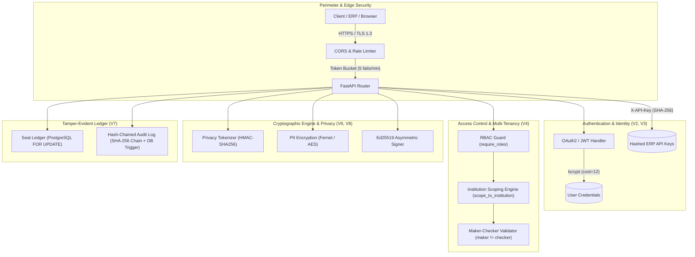

# Security Architecture & ASVS Security Checklist

This document details the security architecture, threat model, and verification controls implemented in the APAAR ID Validation platform. The checklist adheres to the **OWASP Application Security Verification Standard (ASVS) v4.0** requirements.

---

## 1. Security Architecture Summary

---

## 2. OWASP ASVS v4.0 Verification Checklist

### V1: Architecture, Design and Threat Modeling
| Control ID | ASVS Item | Implementation Detail | Status |
| :--- | :--- | :--- | :--- |
| **V1.1.1** | Threat modeling across data flows | Comprehensive threat model addressing dual-enrolment fraud, quota manipulation, deanonymisation attacks, and audit tampering. | ✅ VERIFIED |
| **V1.2.2** | Defence-in-depth architecture | Multi-layer defence: edge rate limiting, route RBAC, row-level SQL filters, database constraint triggers, and cryptographic verification. | ✅ VERIFIED |
| **V1.4.1** | Separation of duties | Dual-control maker-checker architecture (`INST_MAKER` vs `INST_CHECKER`). A maker cannot approve their own batch independently of role. | ✅ VERIFIED |
| **V1.14.1**| Failure state security | All security enforcement gates fail closed (`scope_to_institution` default returns empty rows; invalid tokens abort with HTTP 401). | ✅ VERIFIED |

---

### V2: Authentication
| Control ID | ASVS Item | Implementation Detail | Status |
| :--- | :--- | :--- | :--- |
| **V2.1.1** | Strong password hashing | Passwords hashed using `bcrypt` with cryptographic salt (`passlib` + `bcrypt 4.0.1`). Plaintext passwords never logged or stored. | ✅ VERIFIED |
| **V2.2.1** | Anti-automation / Rate limiting | In-memory sliding window rate limiter on `POST /api/v1/auth/login` (`login_limiter`). Enforces max 5 failed attempts per 60 seconds per IP/account; responds with HTTP 429 (`RATE_LIMITED`) and `Retry-After`. | ✅ VERIFIED |
| **V2.4.2** | Secure API key authentication | ERP/SIS integration via `X-API-Key` headers (FR-39). Tokens use `apaar_live_` prefix with 256-bit entropy, hashed with SHA-256 at rest; raw token is shown only once on generation. | ✅ VERIFIED |
| **V2.8.1** | Non-disclosing error messages | Authentication failures return identical neutral response: `"Incorrect email or password"` (`AUTH_INVALID_CREDENTIALS`) for unknown accounts, wrong passwords, and inactive users. | ✅ VERIFIED |

---

### V3: Session Management
| Control ID | ASVS Item | Implementation Detail | Status |
| :--- | :--- | :--- | :--- |
| **V3.1.1** | Stateless token lifecycle | Short-lived JWT access tokens (15 minutes) signed with HS256 / RS256; rolling refresh tokens (7 days) with rotation on exchange (`POST /api/v1/auth/refresh`). | ✅ VERIFIED |
| **V3.2.1** | Session de-authentication | Deactivating a user (`active = false`) revokes access immediately upon next request because user state is re-validated from the database on every call. | ✅ VERIFIED |
| **V3.4.1** | Anti-tamper claims verification | Token signature and claims (`sub`, `role`, `exp`, `type`) verified on every API invocation using cryptographic decoding. | ✅ VERIFIED |

---

### V4: Access Control
| Control ID | ASVS Item | Implementation Detail | Status |
| :--- | :--- | :--- | :--- |
| **V4.1.1** | Explicit route authorization | Every protected endpoint guards access via `require_roles(...)` dependency enforcing RBAC across all 6 platform roles (`AICTE_ADMIN`, `AICTE_REVIEWER`, `INST_MAKER`, `INST_CHECKER`, `VERIFIER`, `STUDENT`). | ✅ VERIFIED |
| **V4.1.2** | Multi-tenant row scoping | Row-level isolation enforced via single shared query filter `scope_to_institution(...)`. Institution users cannot query, view, or modify data of another institution (returns HTTP 404 neutral). | ✅ VERIFIED |
| **V4.1.3** | Segregation of maker and checker | Enforced at code level: `batch.maker_id != checker.id`. Checker is blocked from approving batches they originated, preventing unauthorized self-authorisation. | ✅ VERIFIED |
| **V4.2.1** | Case visibility isolation | Suspicious cross-institution fraud cases (`DUP_EXACT_CROSS`, `RING`, `ANOMALY`) carry `visibility = AICTE_ONLY` and are hidden from institutions (returning HTTP 404). | ✅ VERIFIED |

---

### V5: Malicious Input Handling & Validation
| Control ID | ASVS Item | Implementation Detail | Status |
| :--- | :--- | :--- | :--- |
| **V5.1.1** | Strict schema validation | All incoming requests validated via Pydantic models with type enforcement, regex constraints, and length boundaries. | ✅ VERIFIED |
| **V5.2.1** | SQL injection protection | 100% parameterised SQL queries using SQLAlchemy 2.0 ORM and Core; zero raw string concatenation in SQL statements. | ✅ VERIFIED |
| **V5.3.1** | Deterministic rule engine | Statutory validation suite (FR-6 to FR-13) validates APAAR 12-digit formatting, Luhn-style check digit validation, admission timeline boundaries, and quota ceilings. | ✅ VERIFIED |
| **V5.5.1** | CSV upload sanitization | File uploads chunked into 64 KB segments, assembled with hash validation, and strictly parsed in memory with delimiter and format sanitization. | ✅ VERIFIED |

---

### V6: Cryptography & Privacy Protection
| Control ID | ASVS Item | Implementation Detail | Status |
| :--- | :--- | :--- | :--- |
| **V6.1.1** | PII field-level encryption | Sensitive student PII (name, phone, email, address, NRI sponsor, OCI number) encrypted at rest using Fernet symmetric encryption (AES-128-CBC + HMAC-SHA256). | ✅ VERIFIED |
| **V6.2.1** | Pseudonymous privacy tokens | Student contact information (phone, email, identity) converted to deterministic HMAC-SHA256 tokens for fuzzy matching and ring detection without revealing plaintext PII. | ✅ VERIFIED |
| **V6.3.1** | Asymmetric Ed25519 digital signatures | Student credentials and offline verification payloads signed using high-security Ed25519 asymmetric cryptography (`cryptography.hazmat`). | ✅ VERIFIED |
| **V6.4.1** | Canonical JSON normalization | Digital signature payloads normalized with RFC 8785 canonical JSON formatting (sorted keys, compact whitespace, UTF-8 encoding) to prevent serialization malleability. | ✅ VERIFIED |
| **V6.5.1** | Cryptographic key rotation | Active keypair stored with unique `key_id`, metadata timestamps, and rotation support via `SigningKey` table; public keys exposed via `/.well-known/public-key`. | ✅ VERIFIED |

---

### V7: Error Handling & Audit Logging
| Control ID | ASVS Item | Implementation Detail | Status |
| :--- | :--- | :--- | :--- |
| **V7.1.1** | Unified error representation | Standardized error format `{ "error": { "code", "message_en", "message_key", "details" } }` preventing internal stack trace or credential leakage. | ✅ VERIFIED |
| **V7.2.1** | Zero-PII audit logging | Audit logs record actor ID, action name, entity type, and entity ID without logging student names, phone numbers, or passwords. | ✅ VERIFIED |
| **V7.3.1** | Hash-chained append-only audit | Every administrative action appended to `audit_log` with cryptographic chain: `hash = SHA256(prev_hash \|\| canonical_json(entry))` under PostgreSQL advisory locks. | ✅ VERIFIED |
| **V7.3.2** | Database write protection trigger | PostgreSQL database trigger (`audit_log_immutable_trigger`) blocks any direct `UPDATE` or `DELETE` query against `audit_log`. | ✅ VERIFIED |
| **V7.4.1** | Cryptographic audit verifier | Built-in verifier (`/audit/verify`) recomputes the entire SHA-256 chain and pinpoints the exact row index of any database tampering. | ✅ VERIFIED |

---

### V8: Data Protection & Privacy Rights
| Control ID | ASVS Item | Implementation Detail | Status |
| :--- | :--- | :--- | :--- |
| **V8.1.1** | Student confirmation & ownership | Enrolment confirmation workflow allows students to elevate records to Trust Tier 3 (T3) or dispute fraudulent enrolments ("Not me"), opening an AICTE dispute case. | ✅ VERIFIED |
| **V8.2.1** | Granular selective disclosure | Students choose specific fields to disclose (e.g. GPA only, programme only) when granting consent to third-party verification requests. | ✅ VERIFIED |
| **V8.3.1** | Consent revocation registry | Students can revoke verification consent at any time; revoked credential hashes are published to `/api/v1/revocations` to invalidate offline verifications. | ✅ VERIFIED |
| **V8.4.1** | Verifier access transparency log | Students inspect full audit trail of third-party verification events (requestor identity, timestamp, purpose, and disclosed fields). | ✅ VERIFIED |

---

## 3. Concurrency & High-Availability Hardening

- **PostgreSQL Row-Level Locking:** Race conditions on programme quotas are eliminated using `SELECT ... FOR UPDATE` row-level locks on `seat_ledger_balance`.
- **Stress-Tested Guarantees:** 50 parallel threads racing against 5 seats consistently yields exactly 5 clean admissions, 45 flagged over-cap admissions, and 0 lost updates.
